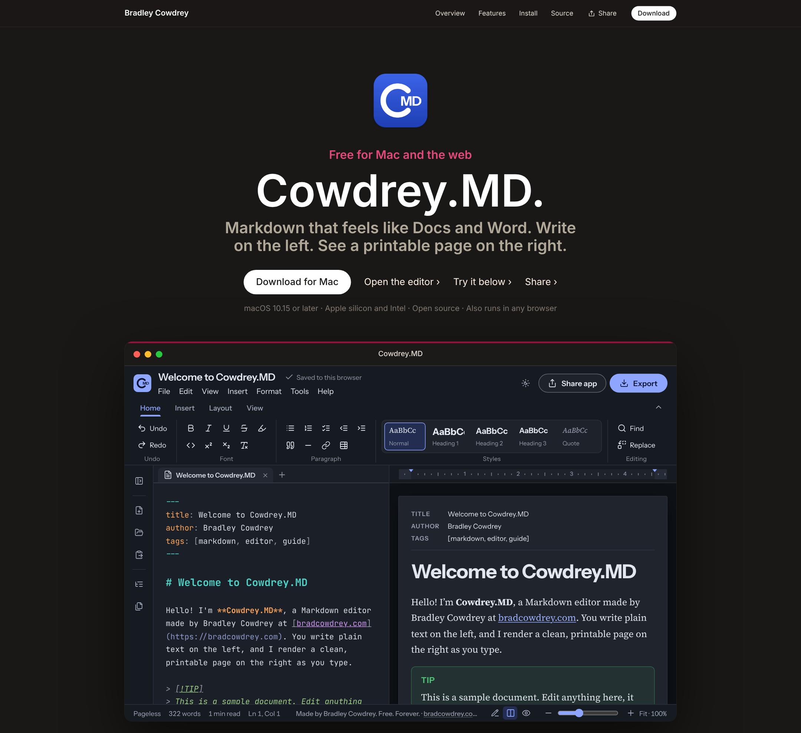

# Cowdrey.MD

A Markdown editor by **Bradley Cowdrey** · [bradcowdrey.com](https://bradcowdrey.com)

It combines MacDown's side-by-side writing, a Docs-style title bar, menus and paper page, and a Word-style ribbon, ruler and status bar. It is one self-contained web page with no build server and no backend.

### [⬇ Download for Mac](https://github.com/bradleycowdrey/cowdrey-md/releases/latest/download/Cowdrey.MD.dmg) · [⬇ Download for Android](https://github.com/bradleycowdrey/cowdrey-md/releases/latest/download/Cowdrey.MD.apk) · iPhone and iPad: coming soon to the App Store · [Open in your browser](https://bradcowdrey.com/cowdrey-md)

[](https://bradcowdrey.com/cowdrey-md)

**Free. Forever.**
- **Mac:** a `.dmg` for Apple silicon and Intel Macs. Open it and drag Cowdrey.MD into Applications. It's signed with an Apple Developer ID and notarized by Apple, so it opens with a double-click, and it keeps itself up to date.
- **Android 8.0 or later:** an `.apk` signed with the Cowdrey.MD upload key. Open it on your phone and tap Install; later versions come from ··· → Check for updates.
- **iPhone and iPad:** in Apple's App Review now (iOS 15 or later).
- **Any browser:** [bradcowdrey.com/cowdrey-md/app](https://bradcowdrey.com/cowdrey-md/app).

[](https://github.com/bradleycowdrey/cowdrey-md/releases/latest)

## What's new

- **1.0.25 and 1.0.26: make Cowdrey.MD your default Markdown app** on iPhone, iPad and Android, as on the Mac. Tap a `.md` file in Files, Drive or Gmail and choose Cowdrey.MD.
- **1.0.21 to 1.0.24: polish from testing on real devices.**
  - One tap opens a document on touch screens.
  - ‹ Documents goes back on a second press.
  - The title bar clears the status bar on Android tablets and iPad.
  - Undo and Redo grey out when there's nothing to undo or redo.
  - Android can check for updates.
- **1.0.20: Cowdrey.MD for Android**, with the same phone layout, Android's file picker for Open and Save, and the Back button.
- **1.0.16: the iPhone layout works like Pages and Word.** Read the page, tap Edit to write, with a formatting bar above the keyboard and Format, Insert, Share and More panels.
- **1.0.14: Cowdrey.MD for iPhone and iPad**, on its way to the App Store. Export opens the share sheet (Save to Files, AirDrop, Mail), and links open in Safari.
- **Cowdrey.MD has a home on bradcowdrey.com.** [bradcowdrey.com/cowdrey-md](https://bradcowdrey.com/cowdrey-md) shows the editor running live in a Mac window, with features, install steps and a Share button. The full-screen editor is at [bradcowdrey.com/cowdrey-md/app](https://bradcowdrey.com/cowdrey-md/app).
- **1.0.9:** better layouts for phones and tablets. In the Mac app, Quit saves your work first, the Edit menu uses the standard Mac items, and keyboard and screen-reader support is better.
- **1.0.8:** a collapsible, resizable sidebar.
- **1.0.6 and 1.0.7:** one-click updates that install and restart, a Share app button, and a Mac menu bar that matches the in-app menus.

See the [changelog](CHANGELOG.md) for every release.

## Features

**On iPhone, iPad and Android**
- A layout in the style of Pages and Word: read your document as a page, tap **Edit** to write, with a formatting bar above the keyboard and Format, Insert, Share and More panels
- Open Markdown files from Files, Google Drive, Gmail or any app, and make Cowdrey.MD your default Markdown app
- Export through the share sheet (iPhone and iPad) or Android's file picker; the Android Back button closes panels and leaves editing
- Dynamic Type, VoiceOver, dark mode, and pinch to zoom the page

**Writing**
- Syntax-highlighted Markdown source (CodeMirror) with spell check, auto-closing brackets, and lists that continue and renumber on Enter
- Word-style ribbon (Home, Insert, Layout, View) with a Styles gallery (Normal, Heading 1–4, Quote, Code)
- Docs-style menus (File, Edit, View, Insert, Format, Tools, Help) and keyboard shortcuts that match Docs where possible
- Find and replace with match case and regular expressions
- Table picker grid, plus **Tidy table** to realign pipes
- Paste or drop pictures (large ones are downscaled automatically); paste a URL over selected text to make a link
- Focus mode, typewriter mode, line numbers, word wrap, four editor themes (including a MacDown-style Night theme)

**Preview**
- Paper page on a canvas with Letter / A4 / Wide / Fluid sizes, margins, page-break guides, a ruler in inches or cm, and zoom
- Page styles: Cowdrey, GitHub, Clearness, Solarized, Manuscript
- GitHub Flavored Markdown: tables, task lists (tick them in the preview), strikethrough, autolinks
- Callouts (`> [!NOTE]`, `TIP`, `IMPORTANT`, `WARNING`, `CAUTION`), footnotes, definition lists, ==highlight==, sub/superscript, emoji shortcodes, front matter, `[TOC]`
- LaTeX math (MathJax), Mermaid diagrams, and highlighted code with copy buttons
- Scroll sync between source and preview based on source-line anchors; double-click the preview to jump to the source

**Documents**
- Open many files at once (Open…, drag and drop, or Finder's Open With); each gets its own tab in a tab bar above the editor and preview
- Tabs work like other apps: drag to reorder; right-click for Close, Close others, Close tabs to the right, Close all, Rename, Duplicate, Show in Finder and Copy file path; Next/Previous tab, ⌃Tab, ⌘1–9 and Reopen closed tab
- Closing every tab shows a "No documents open" screen with New, Open and your recent documents
- The Mac app marks files with unsaved changes with a dot on their tab, asks before closing or quitting with unsaved work, and has Save all and Open recent
- A Recent documents list and an outline of headings
- Autosaves to the browser's local storage
- Open `.md` files, paste as a new document, download `.md` or a standalone `.html`, copy Markdown or HTML, or **Copy for Docs or Word** (rich text)
- Word count dialog with reading and speaking time and a Flesch reading-ease score

## Project layout

```
src/template.html   page markup, styles, welcome document, library tags
src/app.js          the application
src/codemirror.css  CodeMirror 5 base styles (inlined at build time)
build.py            assembles index.html
index.html          the built, single-file app (open it or host it anywhere)
```

Build:

```sh
python3 build.py
```

## Tests

`tests/e2e.mjs` drives the real app in Chromium through 78 scenarios: editing commands, lists, find and replace, tables, pictures, attempted script injection, math and diagrams, tabs and documents, persistence, export, clipboard, sync scroll, zoom, themes, accessibility and large-document speed. It also covers the phone layout (Edit and Done, panels, Back, pinch, edge swipe), the iPhone and Android apps (share sheet, file picker, Open with, update checks), status bars, and touch screens. Two audits run as well: every arrow and chevron control must respond or be greyed out, and no control may appear only on hover. `tests/matrix.mjs` runs every command at five window sizes in light and dark. GitHub Actions runs it on every push (`.github/workflows/tests.yml`).

```sh
(cd desktop && npm ci) && npm install --no-save playwright && npx playwright install chromium
node tests/e2e.mjs
```

## Hosting on bradcowdrey.com

- **https://bradcowdrey.com/cowdrey-md** is the product page, with the live editor embedded.
- **https://bradcowdrey.com/cowdrey-md/app** is the full-screen editor.

bradcowdrey.com serves this repository's GitHub Pages copy (`https://bradleycowdrey.github.io/cowdrey-md/`, deployed from `main`, root folder) at `/cowdrey-md/app`, so every push to `main` reaches it within minutes. Keep that Pages address working: bradcowdrey.com loads the app from it. `index.html` is static, so any other web host works too.

## Mac app

Download the latest `.dmg` from [Releases](https://github.com/bradleycowdrey/cowdrey-md/releases/latest). It runs on Apple silicon and Intel Macs and works offline.

The Mac app checks for a newer release once a day (and from **Help → Check for updates…**). With update signing set up, **Install and restart** downloads the signed update, saves your work, replaces the app and reopens it; otherwise it offers the new DMG. Without that secret, `node desktop/sign-update.mjs <private-key> "<notes>"` signs the released bundle and writes `updates/latest.json`; pushing it publishes the update. Automatic signing needs one repository secret, `TAURI_SIGNING_PRIVATE_KEY`, holding the private key that matches the public key in `desktop/src-tauri/tauri.conf.json`. The DMG is built by GitHub Actions (`.github/workflows/mac-app.yml`) whenever the version in `desktop/src-tauri/tauri.conf.json` changes on `main`, a tag such as `v1.0.1` is pushed, or the workflow is run by hand. The `desktop/` folder wraps `index.html` with [Tauri](https://tauri.app) and copies every library in, so nothing loads from the internet. Releases are signed with the Developer ID certificate and notarized by Apple when the `DEVELOPER_ID_P12`, `DEVELOPER_ID_P12_PASSWORD`, `CODESIGN_IDENTITY`, `NOTARY_APPLE_ID`, `NOTARY_PASSWORD` and `NOTARY_TEAM_ID` secrets are set; Apple's notarization can add anywhere from a few minutes to over an hour to a release build.

## iPhone and iPad app

The same Tauri project builds the App Store app (`.github/workflows/ios-app.yml`), whenever the version or the Rust code changes on `main`. The iPhone app runs the page as it runs on the web, so Mac-only features (menu bar, file paths, self-updates) stay on the Mac; exports go through the iOS share sheet and links open in Safari.

The workflow needs an App Store Connect API key with Admin access, saved as three repository secrets: `APP_STORE_CONNECT_ISSUER_ID`, `APP_STORE_CONNECT_KEY_ID` and `APP_STORE_CONNECT_API_KEY` (the contents of the `.p8` file). With them, Xcode creates the Apple Distribution certificate and App Store profile, and each build goes to TestFlight. Without them, the workflow only checks that the iOS code compiles. The build log is published to the `ios-build-log` branch.

## Android app

`.github/workflows/android-app.yml` builds the Android app (APK and App Bundle) from the same Tauri project whenever the version or the Rust code changes on `main`. It then installs the app on an Android 15 emulator, agrees to the terms, opens the editor, presses Back and switches to dark mode, publishing screenshots and the log to the `android-build-log` branch. The Android app uses the phone layout. Open and Save go through Android's file picker, and the Back button closes panels and leaves editing.

For Google Play, add the upload key as repository secrets: `ANDROID_KEYSTORE` (the `.jks` file, base64), `ANDROID_KEYSTORE_PASSWORD` and `ANDROID_KEY_ALIAS`. The workflow then signs the APK and the App Bundle (`.aab`) for upload. Without them, the APK is signed with a throwaway key, for trying it out only.

## Fonts

Instrument Sans, JetBrains Mono, Source Serif 4 and Tinos are bundled in `fonts/` and embedded into `index.html` at build time, so the app never loads fonts from an outside service and works fully offline. Each font is under the SIL Open Font License; its license file sits next to it.

## Credits

Built with CodeMirror 5, markdown-it, highlight.js, MathJax 3, Mermaid, DOMPurify and Lucide icons. Feature ideas came from studying the open-source editors MacDown, MarkText, Zettlr, StackEdit, Dillinger and ghostwriter, along with Markdot.

## Terms and privacy

Using Cowdrey.MD means agreeing to the [Terms of Use and Privacy](TERMS.md) (also at [bradcowdrey.com/legal](https://bradcowdrey.com/legal)). In short: it's free and provided as is, you use it at your own risk, and your documents stay on your device (in the browser, the app's storage, or files you choose), so keep your own copies of anything important. bradcowdrey.com keeps the email addresses people give it to download the apps, and you can unsubscribe at any time. The app asks you to agree the first time it opens, and **Help → Terms & Privacy** (on phones, **··· → Terms & Privacy**) opens them any time.

## License

MIT © Bradley Cowdrey. See [LICENSE](LICENSE).
